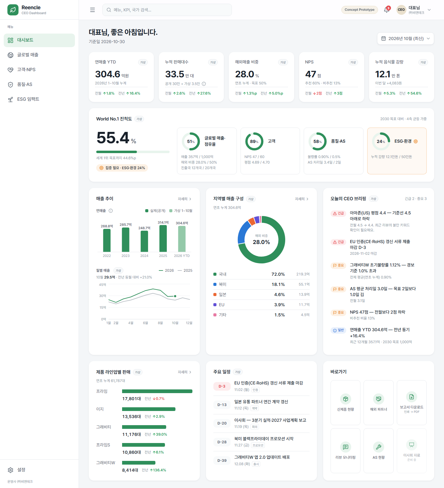
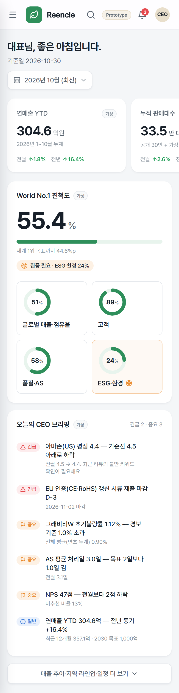

# 린클(Reencle) CEO 글로벌 KPI 대시보드

> **Concept Prototype** — "우리는 세계 1위를 향해 지금 어디쯤 와 있고, 오늘 무엇에 집중해야 하는가?"에 답하는 CEO용 대시보드 웹 프로토타입이에요.
> 백엔드·로그인 없이 정적 데이터로 동작해요.

**바로 보기**: https://kkumbab-note.github.io/reencle-ceo-dashboard/ (GitHub Pages, 공개 주소)

| 데스크톱 (1440px) | 모바일 (390px) |
|---|---|
|  |  |

**실제 값과 가상 값을 구분해요.** 화면의 숫자 대부분은 가상 데이터라 회색 `가상` 배지가 붙어 있어요. 팩트시트(공개자료)에서 온 값에만 ⓘ 아이콘이 붙고, 누르면 출처가 보여요. 해당 값은 2022~2025 연매출, 누적 판매 30만 대, 감량률 98%, 고객충성도 1위 등이에요.

---

## 빠른 시작

**필요한 것**: Node.js 22.22 이상, npm

```bash
npm install
```

```bash
npm run dev
```

브라우저에서 http://localhost:5173 을 열어요.

### 스크립트

| 명령 | 하는 일 |
|---|---|
| `npm run dev` | 개발 서버 (수정하면 바로 반영) |
| `npm run build` | 타입 검사 후 `dist/`에 정적 파일 빌드 |
| `npm run preview` | 빌드 결과물을 http://localhost:4173 에서 확인 |
| `npm test` | 데이터 정합성 테스트 (월별 합계 = 연매출 등 30개) |
| `npm run typecheck` | 타입 검사만 |
| `npm run build:pages` | GitHub Pages용 빌드 (`/reencle-ceo-dashboard/` 하위 경로) |
| `npm run deploy:pages` | GitHub Pages로 배포 (`gh-pages` 브랜치에 올림) |

> 개발 PC의 메모리가 부족하면 Vite 개발 서버가 꺼질 수 있어요. 그럴 땐 `npm run build` 후 `npm run preview`로 확인하면 메모리를 덜 써요.

---

## 배포 — GitHub Pages (현재 사용 중)

코드를 고친 뒤 아래 명령 한 줄이면 공개 주소가 갱신돼요(반영까지 1~2분).

```bash
npm run deploy:pages
```

- 빌드 결과물은 `gh-pages` 브랜치에 올라가요. 저장소 **Settings → Pages**에서 이 브랜치가 배포 대상으로 설정되어 있어요.
- 하위 경로(`/reencle-ceo-dashboard/`)에서 동작하도록 빌드해요. 저장소 이름을 바꾸면 `package.json`의 `build:pages` 안의 `--base` 값도 같이 바꿔요.
- `/sales` 같은 하위 주소로 바로 들어와도 앱이 뜨도록, 빌드할 때 `404.html`을 함께 만들어요([`scripts/prepare-pages.mjs`](scripts/prepare-pages.mjs)).
- ⚠️ **공개 주소예요.** 링크를 아는 누구나 볼 수 있어요. 검색엔진 노출은 `noindex`로 막아 두었지만, 화면 숫자 대부분이 가상이라 외부 공유는 피하는 게 좋아요.

## 배포 — Vercel (선택)

정적 사이트라 서버 설정이 필요 없어요. [`vercel.json`](vercel.json)에 모든 경로를 `index.html`로 보내는 설정이 들어 있어요. 그래서 `/sales` 같은 하위 주소에서 새로고침해도 404가 나지 않아요.

### 방법 A — GitHub 연동 (권장)

1. 이 폴더를 GitHub 저장소에 올려요.
2. [vercel.com](https://vercel.com) → **Add New → Project** → 저장소를 선택해요.
3. 설정은 자동으로 잡혀요. 다르면 아래처럼 맞춰요.
   - Framework Preset: **Vite**
   - Build Command: `npm run build`
   - Output Directory: `dist`
   - Node.js Version: **22.x 이상** (`package.json`의 `engines`를 따라가요)
4. **Deploy**를 누르면 끝이에요. 이후엔 main 브랜치에 푸시할 때마다 자동으로 배포돼요.

### 방법 B — Vercel CLI

```bash
npm i -g vercel
```

```bash
vercel
```

```bash
vercel --prod
```

`vercel`은 미리보기 주소를, `vercel --prod`는 운영 주소를 만들어요.

### 다른 정적 호스팅

`npm run build`로 만든 `dist/` 폴더를 올리면 돼요. 단, 모든 경로를 `/index.html`로 보내는 rewrite 설정이 필요해요.

---

## 화면 구성

| 화면 | 주소 | 핵심 위젯 |
|---|---|---|
| 대시보드 | `/` | KPI 5개 · **World No.1 진척도**(4축 + 종합) · 매출 추이 · 지역별 구성 · 오늘의 CEO 브리핑 · 라인업 · 주요 일정 · 바로가기 |
| 글로벌 매출 | `/sales` | 2030 목표 대비 갭 · 국가별 매출 지도 · 국가·채널 표(정렬) · 해외 비중 추이 · 모델별 판매 |
| 고객·NPS | `/customer` | NPS 추이·구성 · 채널별 평점 · 리뷰 키워드 · 재구매율 |
| 품질·AS | `/quality` | 초기불량률 추이 · 모델별 불량률 · AS 퍼널 · AS 처리일 · 고장 유형 Top5 · 교체 주기 준수율 |
| ESG 임팩트 | `/esg` | 누적 감량 카운터 · CO₂e·소나무·승용차 환산 · 월별 CO₂e · 활성 기기 분포 · 산정 기준 |

- **기준일 변경**: 오른쪽 위에서 월을 고르면(2026-01 ~ 10) 모든 화면의 숫자와 브리핑이 그 시점으로 다시 계산돼요.
- **CEO 브리핑**: 고정 문구가 아니라 데이터에서 규칙으로 만들어요. 평점 4.5 미만, 7일 내 인증 마감, 모델 불량률 1% 초과 같은 규칙이에요.
- **반응형**:
  - 1280px 이상: 사이드바 펼침
  - 768~1279px: 아이콘 사이드바
  - 768px 미만: 햄버거 드로어 + KPI 가로 스와이프. 첫 화면에는 KPI·진척도·브리핑만 보이고, 나머지는 '더 보기'로 펼쳐요.
- 화면별 스크린샷(3개 폭)은 [`docs/screenshots/`](docs/screenshots/)에 있어요.

### World No.1 진척도 계산

- KPI 달성률 = 현재 ÷ 목표. 작을수록 좋은 지표(불량률·AS 처리일)는 목표 ÷ 현재로 계산하고, 최대 100%예요.
- 축 점수 = 그 축 KPI 달성률의 평균
- 종합 점수 = 4개 축 균등 가중(각 25%)

목표치와 가중치는 [`src/data/goals.ts`](src/data/goals.ts) 한 곳에서 바꿔요.

---

## 폴더 구조

```
src/
  data/          데이터 계층 — 화면은 getXxx() 함수로만 읽어요
    company.ts     팩트시트(공개값 + 출처)
    goals.ts       2030 목표·축 가중치
    sales.ts · customer.ts · quality.ts · esg.ts   조회 함수
    progress.ts    World No.1 진척도 계산
    dashboard.ts   메인 KPI·브리핑·일정
    mock/          가상 데이터 표 (2025-01 ~ 2026-10)
    checks.ts      정합성 체크 (npm test, 개발 서버 콘솔)
  components/
    layout/        사이드바 · 상단바 · 기준일 선택
    cards/         KPI·통계 카드, 진척도 띠, 브리핑, 출처 표시
    charts/        선·막대·도넛·지도 차트
  pages/         Dashboard · GlobalSales · Customer · Quality · Esg
  styles/
    tokens.css     색·모양 토큰 (테마는 여기서만 바꿔요)
```

## 데이터 다루기

- 모든 지표에는 `source: 'public' | 'mock'`이 붙어요. 공개값에는 `sourceLabel`, `sourceUrl`, `asOf`도 붙어요.
- 매출은 **백만원 정수**로 저장해요(314.1억 = `31_410`). 화면에서 '억'으로 바꿔 보여줘요.
- 가상 데이터 숫자는 `src/data/mock/*.ts`에서 고쳐요. 고친 뒤 `npm test`를 돌리면 합계가 어긋난 곳을 알려줘요(예: 2025 월별 합계 = 공개 연매출 314.1억).
- **실제 API로 바꿀 때**: 화면 코드는 그대로 두고 `src/data/*.ts`의 `getXxx()` 안쪽만 바꾸면 돼요. 지금은 동기 함수라서, API가 비동기라면 화면에서 불러오는 부분에 로딩 처리를 함께 넣어야 해요.

## 테마(브랜드 컬러) 바꾸기

1. [`src/styles/tokens.css`](src/styles/tokens.css)의 `--rc-primary` 등 값을 바꿔요. 화면 전체가 따라 바뀌어요. Tailwind 기본 팔레트를 꺼 두어서, 토큰 밖의 색은 쓸 수 없어요.
2. **차트 범주색**(`--rc-chart-*`, `--rc-channel-*`)은 색각이상 대비를 고려해 순서까지 검증된 값이에요. 브랜드색과 겹치거나 순서를 바꾸면 대비를 다시 확인해요. 예를 들어 primary를 EU 차트색과 같은 보라로 바꾸면, 도넛에서 국내와 EU가 구분되지 않아요.
3. 브라우저 탭 색(`index.html`의 `theme-color`)과 파비콘(`public/favicon.svg`)은 CSS 변수를 쓸 수 없어서 따로 바꿔야 해요.

---

## [확인필요] 목록

| 항목 | 현재 | 위치 |
|---|---|---|
| 브랜드 공식 컬러 | 임시 그린 `#2F8F5B` · 베이지 · 실버 | `src/styles/tokens.css` |
| 2030 목표치 | 매출 1,000억 · 해외 50% · 20개국 · NPS 60 · 평점 4.7 · 불량률 0.5% · AS 2일 · 누적 감량 50만 톤 | `src/data/goals.ts` |
| 출처 원문 링크 | 확보 3개(한경 고객충성도 기사, IDEA, reencle.co). 나머지는 `sourceUrl: null` | `src/data/company.ts` |
| 아마존 판매가 | 팩트시트 $549 ↔ 2026-10 검색 정가 $699 · 할인가 $479~$499 | `src/data/company.ts` |
| 미생물식 시장 점유율 목표 | 없음 → 진척도 미반영 | `src/data/goals.ts` |
| ESG 환산 계수 | 투입량 0.55kg/일, CO₂e 0.45t/t, 소나무 6.6kg/년, 승용차 2t/년 (모두 가정치) | `src/data/esg.ts` |
| 레퍼런스 디자인(INSA Flow) | 이미지를 받지 못해 프롬프트 설명 기준으로 구현 | — |

## 알려진 제한

- 검색창 · 알림 · 프로필 · 설정은 모양만 있어요.
- 바로가기 중 '보고서 다운로드'는 브라우저 인쇄(PDF 저장)를 열고, '이사회 자료'는 준비 중이에요.

결정 기록 전체는 [`DECISIONS.md`](DECISIONS.md)에 있어요.

## 기술 스택

Vite 8 · React 19 · TypeScript 7 · Tailwind CSS 4 · Recharts 3 · react-simple-maps 5 (+ world-atlas) · lucide-react · react-router 8 · Vitest 5 · Pretendard
